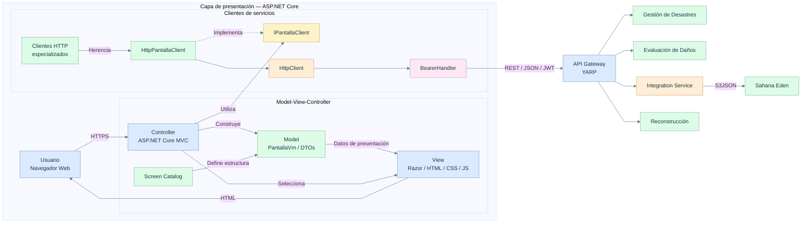
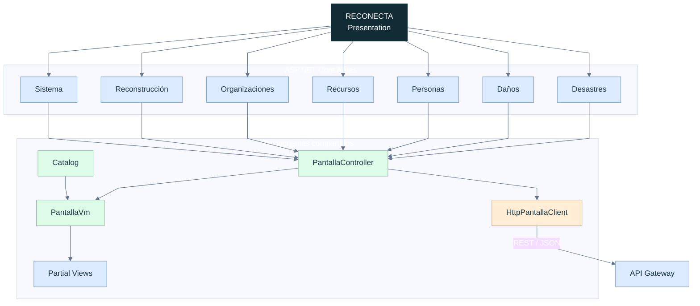
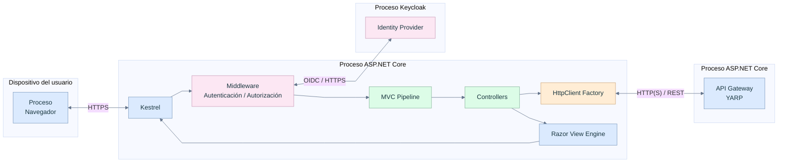
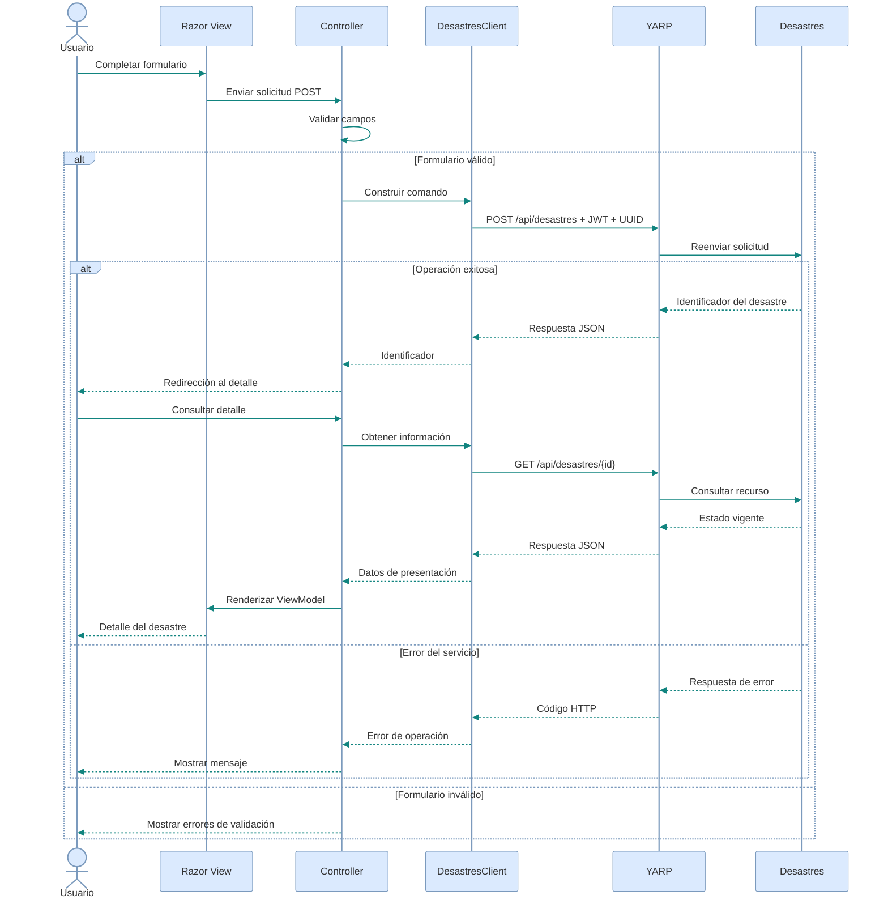
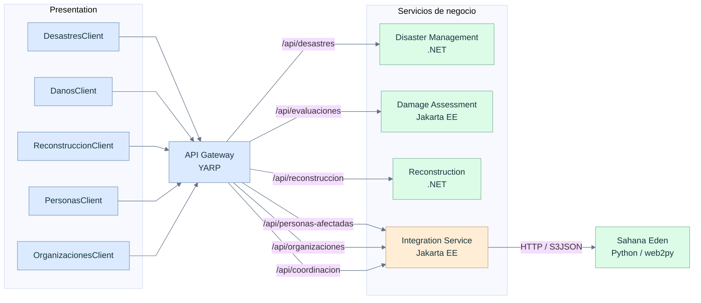
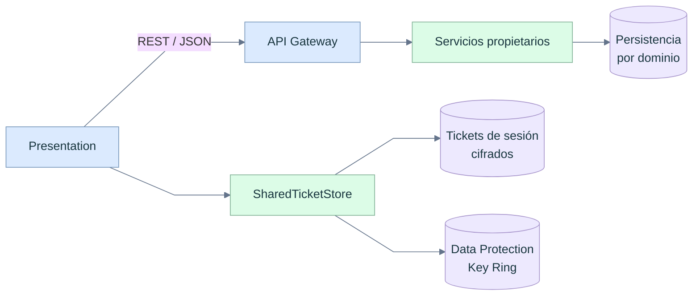
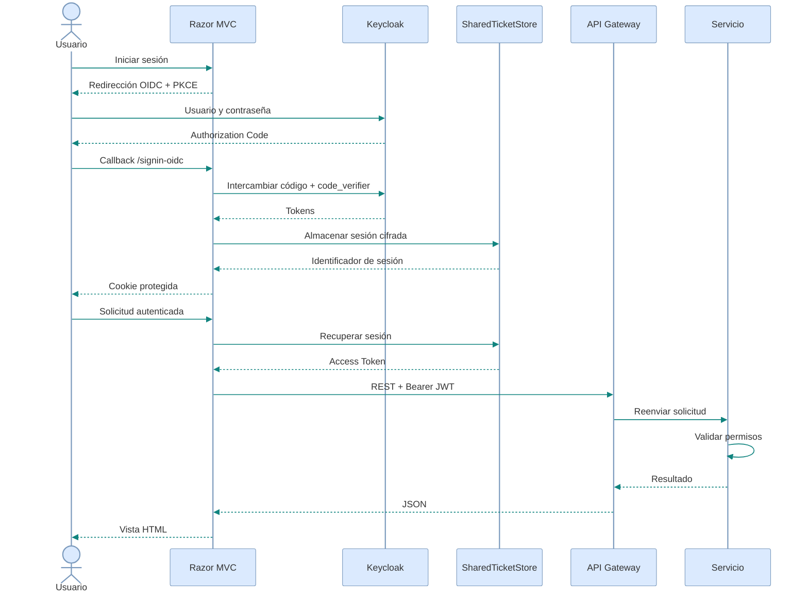
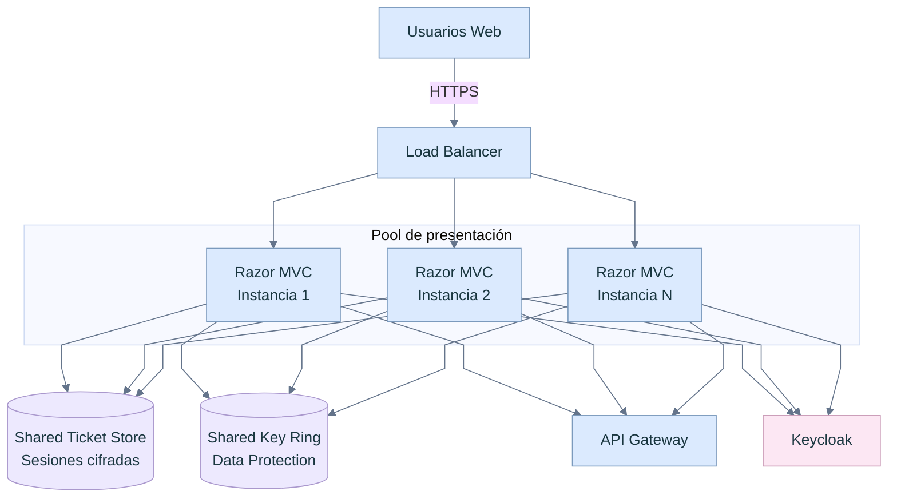

<div align="center">

# RECONECTA

### Platform Presentation

**De la emergencia a la reconstrucción**

Capa de presentación web de la Plataforma para la Gestión de Desastres y Reconstrucción.


**Pontificia Universidad Javeriana**

Arquitectura de Software · 2026

[Plataforma completa](https://github.com/disaster-management-platform/disaster-platform-infrastructure) ·
[Arquitectura](#arquitectura) ·
[Demostración](#demostración) ·
[Instalación](#instalación-y-ejecución)

</div>

---

## Demostración

<div align="center">

[](https://youtu.be/HVCKoTRAxu8)

[Ver demostración funcional de RECONECTA](https://youtu.be/HVCKoTRAxu8)

</div>

## Descripción

`disaster-platform-presentation` implementa la capa de presentación web de RECONECTA, proporcionando una interfaz unificada para acceder a las funcionalidades de gestión de desastres, evaluación de daños, coordinación humanitaria y reconstrucción.

La aplicación implementa el patrón arquitectónico Model-View-Controller (MVC) mediante ASP.NET Core y Razor, separando la representación de la información, el procesamiento de las interacciones del usuario y la comunicación con los servicios de negocio.

La capa de presentación no accede directamente a las bases de datos ni implementa las reglas de negocio de los servicios propietarios. La integración se realiza mediante contratos REST consumidos a través del API Gateway.

Esta separación permite evolucionar la interfaz de usuario independientemente de las tecnologías utilizadas por los servicios de negocio.

## Contenido

- [Funcionalidades](#funcionalidades)
- [Arquitectura](#arquitectura)
- [Decisiones arquitectónicas](#decisiones-arquitectónicas)
- [Tecnologías y justificación](#tecnologías-y-justificación)
- [Estructura del repositorio](#estructura-del-repositorio)
- [Integración con otros componentes](#integración-con-otros-componentes)
- [Persistencia](#persistencia)
- [Contratos de comunicación](#contratos-de-comunicación)
- [Autenticación y gestión de sesiones](#autenticación-y-gestión-de-sesiones)
- [Instalación y ejecución](#instalación-y-ejecución)
- [Pruebas](#pruebas)
- [Repositorios relacionados](#repositorios-relacionados)
- [Autores](#autores)

## Funcionalidades

| Módulo | Funcionalidades |
|---|---|
| Gestión de Desastres | Registro, consulta, clasificación, georreferenciación, ciclo de vida e historial de desastres. |
| Evaluación de Daños | Registro de evaluaciones, clasificación de activos, gestión de evidencias, validación y revisiones. |
| Personas Afectadas | Registro, consulta, actualización y vinculación de personas mediante Integration Service. |
| Gestión de Recursos | Acceso a las interfaces nativas autorizadas de Sahana Eden. |
| Coordinación de Organismos | Directorio de organizaciones, responsabilidades, tareas y actividades. |
| Reconstrucción | Generación de propuestas, formalización, presupuesto, monitoreo y cierre de proyectos. |

Las funcionalidades que no disponen de un contrato integrado permanecen en los sistemas propietarios. La aplicación no sustituye estas operaciones mediante respuestas simuladas durante la ejecución integrada.

### Capacidades transversales

- Navegación contextual por desastre.
- Geolocalización y representación cartográfica.
- Formularios y validación de entradas.
- Indicadores y paneles de seguimiento.
- Gestión de documentos y evidencias.
- Control de versiones de las operaciones.
- Autenticación centralizada.
- Manejo de errores de comunicación.
- Reutilización de componentes visuales.

## Arquitectura

### Patrón arquitectónico MVC

La aplicación forma parte de la Service-Based Architecture de RECONECTA e implementa internamente el patrón Model-View-Controller.

Los controladores utilizan clientes HTTP especializados por dominio para desacoplar la presentación de los mecanismos de comunicación con los servicios de negocio.

### Vista lógica



### Responsabilidades de MVC

| Elemento | Implementación | Responsabilidad |
|---|---|---|
| Model | `PantallaVm`, DTOs y tipos de presentación | Representar el estado y la información requerida por las vistas. |
| View | Razor Views y Partial Views | Generar formularios, tablas, mapas e indicadores. |
| Controller | Controladores ASP.NET Core | Procesar solicitudes, validar entradas y coordinar los clientes HTTP. |

El modelo de presentación es independiente de las entidades persistidas por los servicios de negocio.

### Componentes internos

| Componente | Responsabilidad |
|---|---|
| `PantallaController` | Centralizar el procesamiento de pantallas y formularios. |
| `Catalog` | Definir rutas, campos, tablas, acciones y estructuras de presentación. |
| `PantallaVm` | Representar el estado necesario para renderizar las vistas. |
| `IPantallaClient` | Definir el contrato de comunicación utilizado por los controladores. |
| `HttpPantallaClient` | Reutilizar operaciones HTTP y mecanismos de transformación de respuestas. |
| Clientes especializados | Implementar los contratos particulares de cada dominio. |
| `BearerHandler` | Propagar el token de acceso hacia el Gateway. |
| `SharedTicketStore` | Administrar el almacenamiento compartido y cifrado de sesiones. |
| Partial Views | Reutilizar componentes visuales. |

### Organización funcional

La aplicación utiliza ASP.NET Core Areas para organizar los controladores y clientes según las responsabilidades funcionales de la plataforma.



La organización por áreas reduce el acoplamiento entre módulos funcionales, mientras que los componentes compartidos evitan duplicar mecanismos de presentación y comunicación.

### Vista de procesos

La aplicación web se ejecuta sobre ASP.NET Core y Kestrel.

Las solicitudes son procesadas mediante el pipeline de middleware y los controladores MVC. Los clientes HTTP realizan operaciones asíncronas sobre los servicios remotos, mientras que Razor genera las respuestas HTML.



ASP.NET Core administra concurrentemente las solicitudes de los usuarios. Las operaciones asíncronas evitan mantener innecesariamente ocupados los hilos de ejecución mientras se esperan respuestas de otros servicios.

### Diagrama de secuencia

#### Registro de un desastre



La confirmación de las operaciones depende de las respuestas de los servicios propietarios, evitando presentar modificaciones locales como transacciones exitosas.

## Decisiones arquitectónicas

| Atributo de calidad | Decisión arquitectónica | Tácticas y mecanismos |
|---|---|---|
| Modificabilidad | Model-View-Controller | Separación de responsabilidades. |
| Modificabilidad | Organización por dominios | ASP.NET Core Areas y clientes especializados. |
| Interoperabilidad | Comunicación mediante Gateway | REST, JSON y contratos explícitos. |
| Escalabilidad | Procesamiento concurrente | Operaciones asíncronas y reutilización de conexiones HTTP. |
| Disponibilidad | Preparación para múltiples instancias | Almacenamiento compartido de sesiones y claves. |
| Resiliencia | Manejo de errores | Timeouts y degradación controlada. |
| Seguridad | Identidad centralizada | OIDC, PKCE, JWT y cookies protegidas. |
| Integridad | Delegación al servicio propietario | Idempotencia y control de versiones. |
| Usabilidad | Presentación consistente | Componentes reutilizables, formularios y navegación contextual. |

La implementación de estos mecanismos contribuye al cumplimiento de los atributos de calidad. Su evaluación cuantitativa requiere pruebas sobre el entorno integrado.

## Tecnologías y justificación

### ASP.NET Core y .NET 10


ASP.NET Core proporciona los mecanismos de ejecución, inyección de dependencias, enrutamiento, autenticación y comunicación HTTP requeridos por la aplicación web.

Su selección mantiene afinidad tecnológica con los servicios de Gestión de Desastres, Reconstrucción y API Gateway.

La integración mediante REST permite conservar la independencia tecnológica frente a los servicios Jakarta EE y Sahana Eden.

### ASP.NET Core MVC y Razor


MVC permite separar la representación visual de la información y el procesamiento de las interacciones del usuario.

Razor permite generar interfaces HTML en el servidor utilizando modelos de presentación y componentes reutilizables.

Esta combinación resulta adecuada para RECONECTA debido a la existencia de múltiples módulos administrativos, formularios, tablas y operaciones de seguimiento que comparten una misma estructura visual.

### C#


C# permite implementar clientes HTTP mediante interfaces, comandos tipados, programación asíncrona e inyección de dependencias.

El tipado de los contratos de comunicación reduce errores durante la construcción de solicitudes hacia servicios heterogéneos.

Las abstracciones de los clientes permiten sustituir implementaciones durante el desarrollo y las pruebas sin modificar los controladores.

### HTML, CSS y JavaScript


Estas tecnologías proporcionan la representación y los mecanismos de interacción ejecutados por el navegador.

JavaScript complementa la renderización de Razor mediante comportamientos dinámicos, geolocalización, formularios e interacción con mapas.

Su incorporación permite mantener una aplicación web independiente de los mecanismos internos de ejecución y persistencia de los servicios.

### HttpClient y REST


HttpClient proporciona el mecanismo de comunicación entre los controladores de presentación y las APIs de la plataforma.

La utilización de HttpClientFactory permite centralizar la configuración de conexiones, tiempos de espera y manejadores de autenticación.

REST y JSON permiten integrar servicios implementados en diferentes lenguajes sin establecer dependencias directas sobre sus bibliotecas internas.

### YARP


YARP constituye el punto central de comunicación entre la presentación y los servicios de negocio.

Su selección evita que la aplicación de presentación deba conocer las direcciones individuales de las instancias, facilitando cambios en el despliegue y las estrategias de balanceo.

La implementación del Gateway se mantiene en un repositorio independiente.

### Keycloak


Keycloak permite integrar la autenticación de los usuarios con las políticas de acceso de los servicios desarrollados en .NET y Jakarta EE.

Mediante OpenID Connect y OAuth 2.0, la presentación obtiene una identidad verificable y los tokens requeridos para consumir los contratos autorizados.

Esta decisión evita almacenar contraseñas en la capa de presentación y desarrollar mecanismos de autenticación independientes para cada módulo.

## Estructura del repositorio

```text
disaster-platform-presentation/
│
├── Areas/
│   ├── Danos/
│   │   ├── Clients/
│   │   └── Controllers/
│   ├── Desastres/
│   │   ├── Clients/
│   │   └── Controllers/
│   ├── Organizaciones/
│   │   ├── Clients/
│   │   └── Controllers/
│   ├── Personas/
│   │   ├── Clients/
│   │   └── Controllers/
│   ├── Reconstruccion/
│   │   ├── Clients/
│   │   └── Controllers/
│   ├── Recursos/
│   │   ├── Clients/
│   │   └── Controllers/
│   └── Sistema/
│       ├── Clients/
│       └── Controllers/
│
├── Clients/
│   ├── ApiOptions.cs
│   ├── BearerHandler.cs
│   ├── HttpPantallaClient.cs
│   ├── IIntegrationClient.cs
│   └── IPantallaClient.cs
│
├── Controllers/
│   ├── CuentaController.cs
│   ├── HomeController.cs
│   └── PantallaController.cs
│
├── Screens/
│   ├── Catalog.cs
│   ├── Etiquetas.cs
│   ├── PantallaVm.cs
│   ├── Mock.cs
│   └── Types.cs
│
├── Security/
│   └── SharedTicketStore.cs
│
├── Views/
│   ├── Cuenta/
│   └── Shared/
│
├── Pages/
├── Properties/
│
├── wwwroot/
│   ├── css/
│   └── js/
│
├── scripts/
│   ├── contracts_test.cs
│   ├── disaster_access_test.cs
│   ├── geolocation_test.cjs
│   ├── session_cookie_test.py
│   ├── session_store_test.cs
│   ├── test_oidc.py
│   └── run_local.py
│
├── Program.cs
├── appsettings.json
├── appsettings.Development.json
├── disaster-platform-web.csproj
├── LOCAL_RUN.md
└── README.md
```

| Directorio | Responsabilidad |
|---|---|
| `Areas/` | Controladores y clientes especializados por dominio. |
| `Clients/` | Mecanismos comunes de comunicación HTTP. |
| `Controllers/` | Procesamiento general de las solicitudes. |
| `Screens/` | Modelos y configuración de las pantallas. |
| `Security/` | Gestión del almacenamiento de sesiones. |
| `Views/` | Vistas Razor y componentes reutilizables. |
| `wwwroot/` | Recursos estáticos y comportamiento del navegador. |
| `scripts/` | Ejecución local y pruebas dirigidas. |
| `Program.cs` | Configuración de dependencias, autenticación y middleware. |

## Integración con otros componentes



| Cliente | Servicio propietario |
|---|---|
| `DesastresClient` | Gestión de Desastres. |
| `DanosClient` | Evaluación de Daños. |
| `ReconstruccionClient` | Reconstrucción. |
| `PersonasClient` | Integration Service. |
| `OrganizacionesClient` | Integration Service. |
| `RecursosClient` | Funcionalidades nativas de Sahana Eden; operaciones sin contrato web deshabilitadas. |
| `SistemaClient` | Consultas generales de la plataforma. |

### Integración con Sahana Eden

La aplicación no accede directamente a las bases de datos ni reproduce las reglas de negocio de Sahana Eden.

Las funcionalidades integradas de personas, organizaciones y coordinación utilizan los contratos de Integration Service.

Las operaciones humanitarias que mantienen sus interfaces originales, como familias, expedientes, alojamiento e inventario, se ejecutan mediante Sahana Eden.

### Geolocalización

La aplicación utiliza las coordenadas proporcionadas por el navegador, previa autorización del usuario.

La ubicación descriptiva puede obtenerse mediante un proveedor externo de geocodificación inversa.

Si este proveedor no se encuentra disponible, las coordenadas se conservan y el usuario puede introducir manualmente el municipio o ciudad.

## Persistencia

La capa de presentación no posee una base de datos de negocio.

Los servicios propietarios administran la información de cada dominio, mientras que la presentación consume sus operaciones mediante contratos REST.

El almacenamiento propio de la presentación se limita principalmente a la información necesaria para mantener las sesiones autenticadas.



Los tickets de sesión y las claves criptográficas deben conservarse en un almacenamiento privado, persistente y compartido entre las instancias de presentación.

## Contratos de comunicación

| Origen | Destino | Protocolo |
|---|---|---|
| Navegador | Presentation | HTTPS / HTML |
| Presentation | API Gateway | HTTP(S) / REST / JSON |
| Presentation | Keycloak | HTTPS / OIDC |
| Presentation | Gateway para documentos | HTTP(S) / Multipart |
| Navegador | Geocodificación inversa | HTTPS / JSON |

### Principales endpoints consumidos

| Método | Endpoint | Responsabilidad |
|---|---|---|
| GET | `/api/desastres` | Consultar desastres. |
| POST | `/api/desastres` | Registrar desastre. |
| GET | `/api/desastres/{id}` | Consultar detalle. |
| PUT | `/api/desastres/{id}/fase` | Actualizar fase. |
| GET | `/api/evaluaciones` | Consultar evaluaciones. |
| POST | `/api/evaluaciones` | Registrar evaluación. |
| GET | `/api/personas-afectadas` | Consultar personas. |
| GET | `/api/organizaciones` | Consultar organizaciones. |
| GET | `/api/coordinacion/tareas` | Consultar tareas. |
| POST | `/api/reconstruccion/propuestas/generar` | Generar propuestas. |
| GET | `/api/reconstruccion/proyectos` | Consultar proyectos. |
| POST | `/api/reconstruccion/proyectos/{id}/cerrar` | Cerrar proyecto. |

Los contratos completos se encuentran documentados en los respectivos repositorios propietarios.

### Mecanismos de comunicación

- `Authorization: Bearer`: propagación del token de acceso.
- `Idempotency-Key`: identificación de operaciones.
- `expectedVersion`: control de concurrencia.
- `multipart/form-data`: transferencia de evidencias y archivos.
- SHA-256: verificación de integridad de evidencias de daños.

La validación definitiva de estos mecanismos se realiza en los servicios propietarios.

## Autenticación y gestión de sesiones

La aplicación implementa el flujo Authorization Code con PKCE mediante Keycloak y el cliente confidencial `razor-web`.



| Mecanismo | Responsabilidad |
|---|---|
| OpenID Connect | Autenticación mediante un proveedor externo. |
| Authorization Code + PKCE | Intercambio protegido del código de autorización. |
| Cookie HttpOnly y Secure | Identificación de la sesión del navegador. |
| SharedTicketStore | Persistencia cifrada de los tickets de sesión. |
| ASP.NET Data Protection | Protección criptográfica de sesiones. |
| BearerHandler | Propagación del token de acceso. |
| Antiforgery | Protección de formularios frente a CSRF. |

El inicio de sesión utiliza usuario y contraseña sin MFA obligatorio.

Los JWT completos permanecen en el almacenamiento de sesiones del servidor. El navegador recibe únicamente un identificador de sesión protegido.

La autorización sobre los recursos se realiza en cada servicio propietario mediante sus políticas de roles, organizaciones y ámbito de desastre.

### Escalamiento horizontal



El almacenamiento compartido de sesiones y claves prepara la aplicación para atender solicitudes desde diferentes instancias sin depender exclusivamente de la memoria de un proceso.

La configuración y validación del balanceo efectivo corresponde al repositorio de infraestructura.

## Instalación y ejecución

### Despliegue completo

Para obtener el entorno integrado de RECONECTA, consultar:

**[disaster-platform-infrastructure](https://github.com/disaster-management-platform/disaster-platform-infrastructure)**

Las instrucciones correspondientes al entorno de desarrollo local se encuentran en [LOCAL_RUN.md](LOCAL_RUN.md).

### Prerrequisitos

- .NET SDK 10.
- Git.
- Python 3.
- API Gateway configurado.
- Servicios de negocio disponibles.
- Keycloak configurado.
- Certificados y credenciales autorizados.

### Clonar el repositorio

```bash
git clone https://github.com/disaster-management-platform/disaster-platform-presentation.git

cd disaster-platform-presentation
```

### Restaurar dependencias

```bash
dotnet restore
```

### Compilar

```bash
dotnet build --no-restore
```

### Configuración

| Variable de entorno | Descripción |
|---|---|
| `Api__UseMock` | Selección de clientes reales o simulados. |
| `Api__GatewayUrl` | Dirección del API Gateway. |
| `Api__EdenUrl` | Dirección de las interfaces nativas de Eden. |
| `Api__ReverseGeocodingUrl` | Proveedor de geocodificación inversa. |
| `Security__Authority` | Issuer HTTPS de Keycloak. |
| `Security__ClientId` | Identificador del cliente OIDC. |
| `Security__ClientSecret` | Credencial privada del cliente confidencial. |
| `Security__DataProtectionPath` | Directorio persistente de claves. |
| `Security__SessionStorePath` | Directorio opcional de sesiones. |
| `ASPNETCORE_URLS` | Dirección de escucha de Kestrel. |

Las credenciales, certificados y claves privadas deben mantenerse fuera del repositorio.

### Ejecución integrada local

Desde la raíz de la organización, con los contenedores y perfiles previamente aprovisionados:

```bash
python3 disaster-platform-presentation/scripts/run_local.py start

dotnet restore disaster-platform-presentation

dotnet build disaster-platform-presentation --no-restore

python3 disaster-platform-presentation/scripts/run_local.py web
```

Abrir:

**https://localhost:5081**

Este procedimiento reutiliza el entorno previamente configurado. Para el aprovisionamiento consultar la documentación de infraestructura.

### Direcciones locales

| Componente | Dirección |
|---|---|
| Presentation | `https://localhost:5081` |
| API Gateway | `http://127.0.0.1:18912` |
| Keycloak | `https://localhost:18443/realms/platform` |
| Sahana Eden | `http://localhost:8001/eden_default` |

### Configuración de clientes reales

La ejecución integrada utiliza:

```json
{
  "Api": {
    "UseMock": false
  }
}
```

El modo simulado se encuentra restringido al entorno `Development`.

## Pruebas

### Escenarios de validación

| Escenario | Criterio de aceptación |
|---|---|
| Compilación | Construcción correcta del proyecto. |
| Contratos | Compatibilidad con las APIs propietarias. |
| Registro de desastres | Creación y consulta del recurso registrado. |
| Formularios | Validación de campos y errores. |
| Geolocalización | Captura y conservación de coordenadas. |
| Evidencias | Transferencia correcta de documentos y metadatos. |
| Autenticación | Inicio de sesión mediante Keycloak. |
| Sesiones | Recuperación, expiración y revocación de tickets. |
| Encabezados HTTP | Ciclos de autenticación sin acumulación indebida de cookies. |
| Concurrencia | Manejo de versiones incompatibles. |
| Autorización | Rechazo de operaciones fuera del ámbito permitido. |

### Compilación

```bash
dotnet build
```

### Validación de contratos

```bash
dotnet run --file scripts/contracts_test.cs
```

### Control de acceso a desastres

```bash
dotnet run --file scripts/disaster_access_test.cs
```

### Geolocalización

```bash
node --test scripts/geolocation_test.cjs
```

### Almacenamiento de sesiones

```bash
dotnet run --file scripts/session_store_test.cs
```

### Autenticación OIDC

```bash
python3 scripts/test_oidc.py
```

### Regresión de cookies y encabezados HTTP

```bash
python3 scripts/session_cookie_test.py
```

Las pruebas que requieren servicios externos deben ejecutarse utilizando un entorno configurado, certificados confiables e identidades sintéticas autorizadas.

Las credenciales de prueba se suministran externamente y no se incluyen en el repositorio.

## Repositorios relacionados

| Repositorio | Responsabilidad | Relación con Presentation |
|---|---|---|
| [Infrastructure](https://github.com/disaster-management-platform/disaster-platform-infrastructure) | Despliegue integral | Configuración y ejecución. |
| [API Gateway](https://github.com/disaster-management-platform/disaster-api-gateway) | Enrutamiento y balanceo | Punto de consumo de las APIs. |
| [Disaster Management](https://github.com/disaster-management-platform/disaster-backend-offline) | Gestión de desastres | Cliente HTTP especializado. |
| [Damage Assessment](https://github.com/disaster-management-platform/disaster-damage-assessmet-service) | Evaluación de daños | Cliente HTTP especializado. |
| [Integration Service](https://github.com/disaster-management-platform/disaster-integration-service) | Interoperabilidad y ACL | Personas, organizaciones y coordinación. |
| [Reconstruction](https://github.com/disaster-management-platform/reconstruction-business-layer) | Reconstrucción | Cliente HTTP especializado. |
| [Sahana Eden](https://github.com/disaster-management-platform/sahana-eden) | Gestión humanitaria | Funcionalidades integradas y nativas. |
| [Mobile Client](https://github.com/disaster-management-platform/disaster-mobile-client) | Aplicación móvil | Cliente complementario Offline First. |
| [Platform DAL](https://github.com/disaster-management-platform/disaster-platform-dal) | Persistencia compartida | Dependencia indirecta de los servicios .NET. |

---

## Autores

<div align="center">

**Pontificia Universidad Javeriana**

Facultad de Ingeniería

Departamento de Ingeniería de Sistemas

Arquitectura de Software · 2026-30

| Integrantes |
|:---:|
| Juan Felipe Rodríguez |
| Viviana Gómez León |
| Valeria Catalina Caycedo Ramírez |
| Sofía Guerra Jiménez |

**Docente:** César Julio Bustacara Medina

---

### RECONECTA

*De la emergencia a la reconstrucción.*

</div>